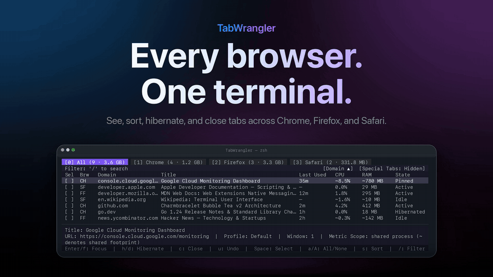

# TabWrangler

TabWrangler is a fast, keyboard-driven Terminal User Interface (TUI) for macOS, Windows, and Linux that provides centralized visibility, telemetry correlation, and lifecycle control over open tabs across Google Chrome, Mozilla Firefox, and Apple Safari.

[](assets/tabwrangler-demo.mp4)

*Demo with simulated tab data*

https://github.com/user-attachments/assets/cfb2d2dd-d0b0-43fb-9d08-118fc550cc27


> **Quick Start:** To install a pre-built binary and launch TabWrangler in under two minutes without compiling from source, jump down to [3. Quick Start & Installation](#3-quick-start--installation).

---

## 1. Features

- **Unified Cross-Browser Viewport:** Inspect tabs across Chrome, Firefox, and Safari in a single virtualized table, with single-key switching to isolate individual browsers (`0`–`3`, `[` / `]`).
- **Resource Footprint & Honest Telemetry:** Measure tab CPU and RAM on demand, with visual indicators (`~`) distinguishing exact single-tab metrics from shared renderer processes.
- **Fast Lifecycle Actions:**
  - **Focus (`Enter` / `f`):** Bring any window and tab directly to the foreground.
  - **Hibernate (`h`):** Unload tabs from memory to reclaim RAM while keeping them open in the browser. A tab showing in its browser window cannot be unloaded, so TabWrangler first switches that window to another loaded tab.
  - **Close (`c`):** Close single or bulk-selected tabs, guarded by confirmation for batches greater than 3 tabs.
  - **Undo (`u`):** Reopen closed tabs or wake hibernated tabs back into active memory.
- **No Background Service:** Nothing runs at login. While the UI is open it refreshes every 5 seconds, on demand (`r`), and after each action. Quitting stops all refreshing.
- **Internal Tab Filtering:** Filters `chrome://*`, `about:*`, and blank tabs by default; toggled instantly with `t`.

---

## 2. Requirements

### Supported Operating Systems
- **Windows:** Windows 10 (build 1809+) or Windows 11 (64-bit only).
- **macOS:** macOS 12 Monterey or later (Apple Silicon or Intel 64-bit).
- **Linux:** Modern Linux distributions with glibc (x86_64, arm64).

> **Compatibility Notice:**
> - **Unsupported:** Windows 7, Windows 8, Windows 8.1, and all 32-bit (x86) operating systems are not supported.
> - Attempting to launch TabWrangler on Windows 7 or 32-bit Windows triggers `not a valid win32 application` due to modern 64-bit Go runtime dependencies and Windows 10+ Virtual Terminal (ConPTY) requirements.

### Supported Browsers
- **Google Chrome / Microsoft Edge / Brave:** Supported via companion WebExtension.
- **Mozilla Firefox:** Supported via companion WebExtension (or session fallback).
- **Apple Safari:** Supported out of the box on macOS via native automation (zero extensions required).

### Development Toolchain (Optional)
- **Go:** Go 1.24+ (only required if building from source).

---

## 3. Quick Start & Installation

### 3.1 One-Command Automated Installation (macOS & Linux)

Install the pre-compiled binary and automatically configure browser native messaging manifests in a single command:

```bash
curl -fsSL https://raw.githubusercontent.com/sancheza/tabwrangler/main/install.sh | bash
```

The script automatically detects your OS and CPU architecture (Apple Silicon, Intel x86_64, ARM64), downloads the latest binary to `~/.local/bin/tabwrangler`, and registers the native messaging manifests.

> [!NOTE]
> **Windows:** `install.sh` does not run on Windows. Follow [3.2](#32-manual-installation-pre-compiled-binaries) and download `tabwrangler-windows-amd64.zip`.

---

### 3.2 Manual Installation: Pre-Compiled Binaries

Download the archive for your operating system from the [Latest Release](https://github.com/sancheza/tabwrangler/releases/latest):

| Platform | Download | Package Contents |
|:--- |:--- |:--- |
| **Windows (x64)** | [tabwrangler-windows-amd64.zip](https://github.com/sancheza/tabwrangler/releases/latest/download/tabwrangler-windows-amd64.zip) | `tabwrangler.exe`, `extension/` directory |
| **macOS (Apple Silicon)** | [tabwrangler-darwin-arm64](https://github.com/sancheza/tabwrangler/releases/latest/download/tabwrangler-darwin-arm64) | Standalone binary |
| **macOS (Intel)** | [tabwrangler-darwin-amd64](https://github.com/sancheza/tabwrangler/releases/latest/download/tabwrangler-darwin-amd64) | Standalone binary |
| **Linux (x86_64)** | [tabwrangler-linux-amd64](https://github.com/sancheza/tabwrangler/releases/latest/download/tabwrangler-linux-amd64) | Standalone binary |
| **Linux (ARM64)** | [tabwrangler-linux-arm64](https://github.com/sancheza/tabwrangler/releases/latest/download/tabwrangler-linux-arm64) | Standalone binary |

Extract the ZIP archive (Windows) or mark the downloaded binary executable (macOS/Linux):

**Windows (Command Prompt or PowerShell):**
```cmd
tar -xf tabwrangler-windows-amd64.zip
```

**macOS:**
```bash
chmod +x tabwrangler-darwin-*
mv tabwrangler-darwin-* tabwrangler
```

**Linux:**
```bash
chmod +x tabwrangler-linux-*
mv tabwrangler-linux-* tabwrangler
```

After preparing the binary, proceed to [3.4 Register and Load the Companion Extension](#34-register-and-load-the-companion-extension).

### 3.3 Build from Source

Objective: Compile the application binary directly from the Git repository.

```bash
git clone https://github.com/sancheza/tabwrangler.git
cd tabwrangler
go build -o tabwrangler ./cmd/tabwrangler
```

Expected output: An executable binary `tabwrangler` (or `tabwrangler.exe` on Windows) generated in the current directory.

### 3.4 Register and Load the Companion Extension

Objective: Connect TabWrangler to Chrome, Edge, Brave, and Firefox. Safari needs no extension.

1. Register the native messaging host:
   ```bash
   tabwrangler setup
   ```
   Expected output: `[OK] Setup complete!` (on Windows, `.\tabwrangler.exe setup`).
2. Load the extension from the `extension/` folder:

   | Browser | Steps |
   |:--- |:--- |
   | Chrome / Edge / Brave | Open `chrome://extensions`, enable **Developer mode**, click **Load unpacked**, select `extension/` |
   | Firefox | Open `about:debugging#/runtime/this-firefox`, click **Load Temporary Add-on...**, select `extension/manifest.json` |
   | Safari (macOS) | No extension. Allow the Automation prompt on first launch. |

3. Launch:
   ```bash
   tabwrangler
   ```

Platform details, expected output, and Firefox notes: [Installation Guide](docs/installation.md). Upgrading: [Upgrading Guide](docs/upgrading.md).

---

## 4. CLI Usage & Flags

| Command | Purpose |
|:--- |:--- |
| `tabwrangler` | Launch the interactive UI |
| `tabwrangler setup` | Register the native messaging host |
| `tabwrangler --update` | Install the latest release (`--dry-run`: check only) |
| `tabwrangler --mock` | Launch with simulated tab data |
| `tabwrangler -h` | Show all flags and shortcuts |

Full flag list and examples: [CLI Reference](docs/cli.md).

---

## 5. Keyboard Navigation & Shortcuts

### Core Concepts

| Concept | Key | Behavior | Browser Tab Strip | Memory / CPU Impact |
|:--- |:--- |:--- |:--- |:--- |
| **Hibernate** | `h` | Puts tab to sleep using browser memory saver engine (`tabs.discard()`). | **Remains open in browser tab strip.** Retains title, URL, and favicon. Clicking wakes instantly from cache. | Frees ~90%+ renderer RAM and completely halts background CPU cycles. |
| **Close** | `c` | Permanently destroys and removes the tab (`tabs.remove()`). | **Deleted completely.** Tab is removed from the browser window. | Process and memory fully purged. |
| **Undo** | `u` | Reverts your last mutation. | Re-creates closed tabs or wakes hibernated tabs back into memory. | Restores previous tab state. |

### Shortcuts

Every key is shown in lowercase. A capital letter does the same thing (Caps Lock is harmless). The keys `A`, `D`, `G`, `S`, and `U` from earlier versions are retired: they show a hint naming the new key and do nothing else.

| Key | Context | Action |
|:--- |:--- |:--- |
| `j` / `k` or `↑` / `↓` | Navigation | Move cursor down / up |
| `g` or `Home` | Navigation | Jump to top of tab list |
| `End` | Navigation | Jump to bottom of tab list |
| `Enter` or `f` | Actions | Focus tab and bring browser window to the front |
| `h` | Actions | Hibernate memory for highlighted tab (or all selected tabs; keeps tab in browser). A tab showing in its window is hibernated after that window switches to another loaded tab |
| `c` | Actions | Close highlighted tab (or all selected tabs; asks confirmation if > 3 tabs) |
| `u` | Actions | Undo last close or hibernate action (reopens closed tabs or wakes hibernated tabs) |
| `Space` | Selection | Toggle checkbox selection on highlighted tab |
| `a` | Selection | Select all visible tabs; press again to clear the selection |
| `0`–`3` or `[` / `]` | Filters | Switch browser tab filter: `[0] All`, `[1] Chrome`, `[2] Firefox`, `[3] Safari` |
| `/` | Filters | Enter live search filter (matches `Title`, `URL`, `Domain`) |
| `Esc` | Filters | Clear search filter or dismiss modal |
| `s` | Sorting | Step sort direction (most ⇄ least, A ⇄ Z), then advance to next column |
| `o` | Sorting | Invert current sort direction |
| `t` | Display | Toggle visibility of internal/special tabs (`chrome://*`, `about:*`, `file://*`) |
| `v` | Display | Toggle full URL column visibility |
| `r` | Lifecycle | Refresh tab snapshot and host process telemetry on demand |
| `?` | Helpers | Toggle in-app help modal explaining concepts and shortcuts |
| `i` | Helpers | Toggle in-app diagnostics modal: bridge connection status and the version of each companion extension |
| `q` / `Ctrl+C` | Lifecycle | Quit TabWrangler |

---

## 6. How It Works

TabWrangler has three parts: the terminal UI, a companion browser extension, and a small bridge host that the browser starts.

| Part | Runs | Listens | Can do |
|:--- |:--- |:--- |:--- |
| **Terminal UI** (`tabwrangler`) | Only while you run it | A local socket (macOS/Linux) or `127.0.0.1:42823` (Windows). No network-facing port. | Show tabs and send commands |
| **Bridge host** (`tabwrangler bridge`) | While the browser keeps the extension connected, even if the UI is closed | Nothing | Relay messages between the browser and the UI |
| **Companion extension** | While the browser runs | Nothing | List, focus, hibernate, close, and reopen tabs (`tabs` permission) |

- **Safari:** the UI controls Safari through macOS Automation (`osascript`). No extension.
- **Authentication:** each UI run creates a random 256-bit token in an owner-only file. The bridge host presents it when it registers.
- **No service:** nothing starts at login, and `tabwrangler --update` is the only network access.

Components, data flow, long-running processes, listeners, permissions, files, and risks: [How TabWrangler Works](docs/architecture.md).

---

## 7. Privacy & Security Architecture

We take security and privacy very seriously. TabWrangler operates on your local machine and collects no data. Its only network request is the optional `tabwrangler --update` command, which contacts github.com when you run it. While we encourage you to review the source code directly, we want to be completely transparent about the specific permissions required and why they are necessary.

### Browser Permissions Breakdown

When loading the companion extension, browsers prompt for two permissions:

| Permission Warning | Technical Permission | Why TabWrangler Needs It | What It Actually Does / Does Not Do |
|:--- |:--- |:--- |:--- |
| **"Read your browsing history"** | `"tabs"` | Tab listing, domain aggregation, and switching | **Only inspects currently open tabs** (titles, URLs, active window IDs) so the terminal UI can display them. It **cannot** and **does not** read your past browsing history, search logs, bookmarks, cookies, or cached session data. |
| **"Communicate with cooperating native applications"** | `"nativeMessaging"` | Local loopback bridge communication | Sends open tab metadata directly to the local TabWrangler process on your machine via standard OS standard input/output pipes. It **does not** communicate with any remote servers or third-party applications. |

### Security & Data Handling Guarantees

1. **No Background Network Requests**: The companion extension contains no `fetch()`, `XMLHttpRequest`, analytics libraries, or telemetry calls. The Go TUI makes no network requests while you use it. `tabwrangler --update` contacts `api.github.com` and `github.com` over HTTPS, only when you run it, and refuses to install a download that does not match the release's `SHA256SUMS` file.
2. **Localhost Only**: Communication between the browser extension and TabWrangler uses standard WebExtension Native Messaging (`stdin`/`stdout` managed directly by the browser executable) and a local IPC channel: a Unix domain socket (mode `0600`) on macOS/Linux, or a loopback-only TCP port (`127.0.0.1:42823`) on Windows.
3. **Authenticated IPC**: Each run generates a random 256-bit token, stored in an owner-only (`0600`) file. The native messaging host reads it and presents it when registering; connections without the correct token are rejected. The token file is deleted on exit.
4. **No Persistent History Stored**: Tab metadata exists in volatile memory only while TabWrangler is running. When you exit (`q`), all tab representations are wiped from memory. No database, SQLite file, or record of visited sites is written to disk. When the Firefox extension is not connected, TabWrangler reads Firefox's own session-recovery file to list Firefox tabs (read-only).
5. **Minimal Permission Footprint**: The extension requests strictly `"tabs"` and `"nativeMessaging"`. It declares no `host_permissions` (`<all_urls>`), no `storage` permission, no `webRequest` interception, and no content scripts injected into websites.
6. **Auditable Source Code**: Both the Go terminal client and the JavaScript extension are open-source. The entire background worker script is contained in a single inspectable file ([extension/background.js](extension/background.js)).

### Files Written to Disk

Socket, token, log, manifests, registry keys, and the files TabWrangler reads: [Files and System Changes](docs/architecture.md#6-files-and-system-changes).

The diagnostic log (`/tmp/tabwrangler-<uid>.log` on macOS/Linux, `%LOCALAPPDATA%\TabWrangler\tabwrangler.log` on Windows) contains no tab titles or URLs. Delete it at any time:

```bash
rm /tmp/tabwrangler-$(id -u).log
```

---

## 8. Reporting Security Issues

See [SECURITY.md](SECURITY.md).

---

## 9. Contributing

See [CONTRIBUTING.md](CONTRIBUTING.md). Release history is in [CHANGELOG.md](CHANGELOG.md).

---

## 10. License

[PolyForm Noncommercial License 1.0.0](LICENSE).

| Use | Allowed |
|:--- |:--- |
| Personal use, hobby projects, research, education | Yes |
| Use by charities, schools, and public safety or government organizations | Yes |
| Modify and share for any noncommercial purpose | Yes, with the license text and the `Required Notice` line |
| Use in or for a commercial product, service, or business | Requires a separate commercial license |

For a commercial license, open an issue titled "Commercial license" at <https://github.com/sancheza/tabwrangler/issues>.
